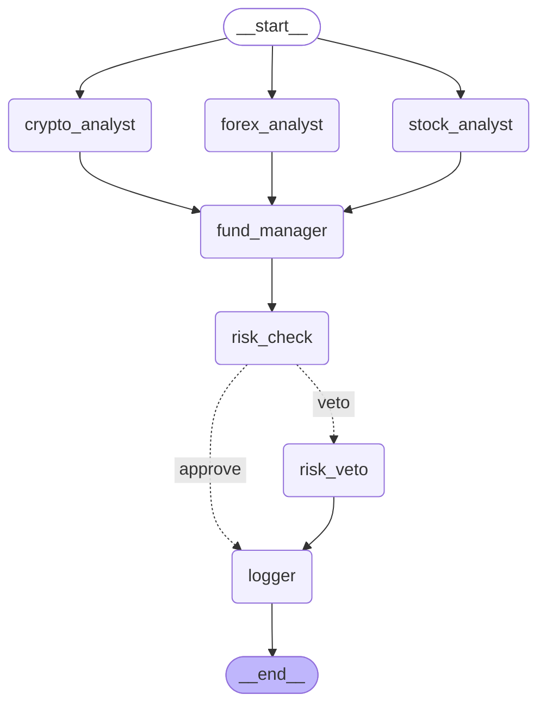

# Multi-Agent Hedge Fund

A team of AI analysts (crypto, stocks, forex) independently research their asset class, a Fund Manager combines their views into a real, mathematically-optimized portfolio allocation, and a Risk Manager can override that allocation entirely if markets turn extreme — every decision logged for full auditability.

Inspired by the multi-agent architecture in **HedgeAgents: A Balanced-aware Multi-agent Financial Trading System** (Li et al., WWW Companion '25) — simplified in places (see [Design Decisions](#design-decisions--honest-limitations) below) to be buildable end-to-end as a learning project.

## Architecture



**Flow:**
1. **Three analysts run in parallel** (LangGraph fan-out) — each fetches real price data (`yfinance`) and news for its asset class, and an LLM produces a structured verdict: `signal` (bullish/bearish/neutral), `confidence` (0-1), and `reasoning`.
2. **Fund Manager** converts each verdict into an expected-return estimate, pulls 60 days of historical price covariance, and runs a real **mean-variance portfolio optimizer** (`scipy.optimize`) to compute allocation weights — not an LLM guess. An LLM then writes a plain-English explanation of the math-driven decision.
3. **Risk Manager** checks real recent volatility against a hard rule (>5% single-day move, or >10% cumulative 3-day move — matching HedgeAgents' Extreme Market Conference trigger). If tripped, a conditional edge routes to a veto node that halves every risky position and moves the freed capital to cash.
4. **Logger** writes every run's full reasoning trail — every analyst's verdict, the risk assessment, and the final decision — to `logs/decisions.jsonl`, regardless of which path fired.

## Setup

```bash
python -m venv venv
source venv/bin/activate  # or venv\Scripts\activate on Windows
pip install -r requirements.txt
```

Create a `.env` file:

Get a free key at https://console.groq.com/keys.

## Usage

**Run a live decision** (uses real current prices + news):
```bash
python main.py
```

**Run a historical backtest** (20 simulated trading days, no look-ahead):
```bash
python -m backtest.run_backtest
```

## Backtest Results

20 simulated trading days, replaying real historical prices with zero look-ahead. See [Design Decisions](#design-decisions--honest-limitations) for what the backtest does and doesn't account for.

| Metric | Agent System (risk_aversion=2.0) | Agent System (risk_aversion=0.3, recalibrated) | Naive Equal-Weight Baseline |
|---|---:|---:|---:|
| Total return | -0.90% | **+1.07%** | +3.69% |
| Annualized return (extrapolated) | -10.74% | **+14.29%** | +57.87% |
| Sharpe ratio | -2.93 | **+1.68** | +2.85 |
| Max drawdown | -1.25% | -1.39% | -2.43% |

**What this shows:** the initial `risk_aversion=2.0` setting caused the optimizer to almost completely ignore analyst signals in favor of whatever asset had the lowest volatility (EUR/USD), because the risk penalty structurally dwarfed the maximum possible expected-return signal for any volatile asset. Backtesting against a naive baseline exposed this — recalibrating to `risk_aversion=0.3` fixed the responsiveness (Sharpe went from -2.93 to +1.68) and produced a genuinely tighter max drawdown than the baseline, at the cost of some upside during this particular rally window. This is a real calibration finding surfaced by the backtest, not a cherry-picked result — the raw comparison and reasoning are left in for transparency.

## Design Decisions & Honest Limitations

- **Asset-class analysts, not analysis-type analysts.** Following the paper, each analyst owns one asset class (crypto/stocks/forex) and does all its own analysis internally, rather than splitting by analysis type (fundamentals/news/technicals) across a single asset.
- **Simplified portfolio math.** The paper uses a full CVaR-based optimization (Value-at-Risk simulation); this project uses plain mean-variance optimization for tractability.
- **No historical news in the backtest.** The free news source (`yfinance`) only returns *current* headlines regardless of the date requested — there's no way to fetch news as it existed on a past date without a paid historical news API. Feeding today's news into a decision simulated weeks ago would be data leakage, so the backtest reasons on price action alone. The live pipeline (`main.py`) does use real current news.
- **No per-day LLM rationale in the backtest**, to keep total LLM calls manageable on free-tier rate limits. Only the deterministic, math-computed weights are backtested; the live pipeline still generates full natural-language rationales every run.
- **No SEC filings integration.** The original plan included filings data; this build uses price + news only.
- **No memory/experience-sharing system.** The paper's agents retain memory across decisions and share experience in periodic conferences (their Experience Sharing Conference). This project's agents are stateless between runs — a natural next extension.
- **Short backtest window (20 days).** Long enough to prove the pipeline works and to surface a real calibration bug, too short for statistically reliable Sharpe/drawdown estimates (the paper backtests over 3 years).

## Possible Future Work

- Add a memory system (vector similarity search over past decisions + outcomes) so agents can reference historical analogues, mirroring the paper's Experience Sharing Conference
- Add SEC EDGAR filings as a data source for the stock analyst
- Full CVaR-based optimization instead of mean-variance
- Paper-trading mode: run the live pipeline daily and track hypothetical P&L over time
- Calibrate `_signal_to_expected_return` against realized backtest outcomes instead of a fixed constant

## Credits

Architecture inspired by: Li, X., Zeng, Y., Xing, X., Xu, J., & Xu, X. (2025). *HedgeAgents: A Balanced-aware Multi-agent Financial Trading System.* WWW Companion '25. https://hedgeagents.github.io/